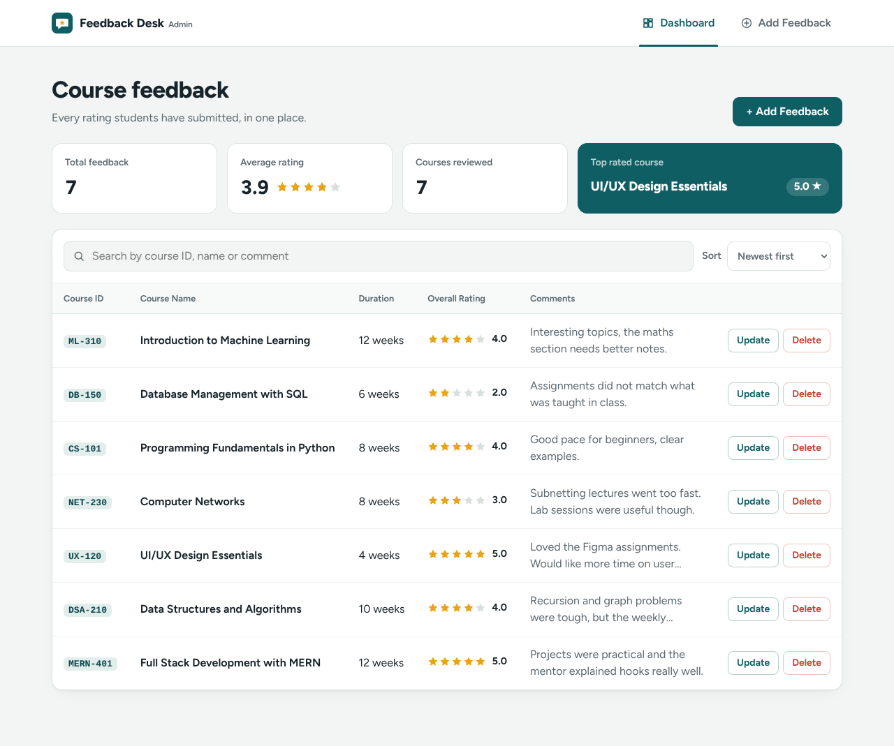
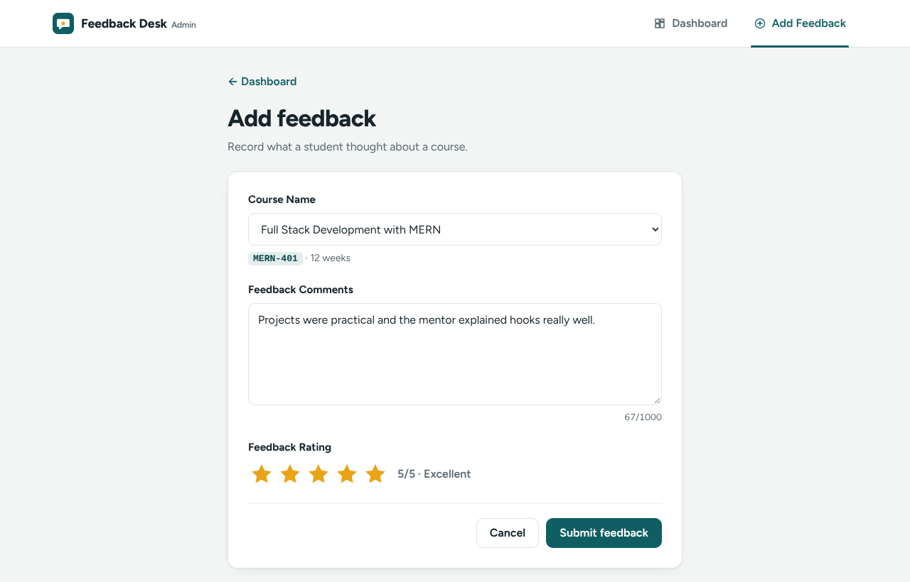
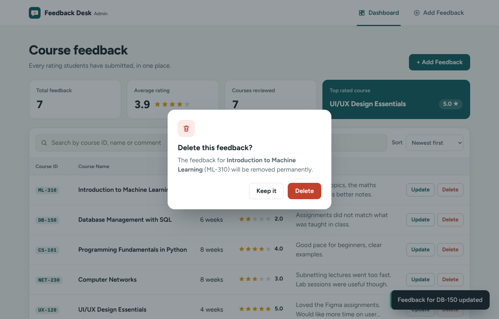
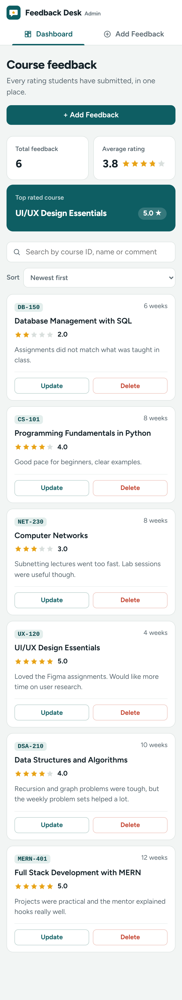

# Feedback Desk: Admin Panel for a Feedback Application  using MERN STACK

An admin panel used for managing course feedback as admins can see all feedback on a dashboard, add new feedback, update existing entries and delete them howevr way they wish.

**Stack:** MongoDB Atlas · Express.js · React (Vite + React Router) · Node.js

```
project-root/
├── backend/     Node.js + Express REST API, Mongoose models, MongoDB Atlas connection
├── docs/        Has screenshots of how it looks in Desktop and Mobile
└── frontend/    React admin panel which includes Dashboard and Add Feedback
```

## Features

| Requirement | Implementation |
| --- | --- |
| Dashboard listing Course ID, Course Name, Course Duration, Overall Feedback Rating | `frontend/src/pages/Dashboard.jsx`: a table (cards on mobile) with star ratings, plus summary stats: total feedback, average rating, courses reviewed and top-rated course |
| Navbar with **Dashboard** and **Add Feedback** tabs, with routing | `frontend/src/components/Navbar.jsx` with React Router (`/dashboard`, `/add-feedback`) |
| Update and Delete buttons on each feedback row | Update opens `/feedback/:id/edit` with the form already filled; Delete asks for confirmation first |
| Add Feedback form: Course Name, Feedback Comments, Feedback Rating | `frontend/src/pages/FeedbackFormPage.jsx`: course dropdown, comments box with character counter, 1–5 star picker |
| Backend in Node.js, database on MongoDB Atlas | `backend/`: Express + Mongoose; the connection string is in `backend/.env` |
| Attractive, responsive UI | Custom CSS (`frontend/src/styles.css`); the table turns into cards on phones, and there are loading, empty, error and success (toast) states |

Extras: search and sort on the dashboard, validation on both the browser and the server with messages next to each field, and keyboard-accessible star rating and dialogs.

### How the data fits together

- **Course:** `courseId`, `name`, `duration`. Eight courses are added to the database automatically the first time the backend starts (`backend/data/courses.js`).
- **Feedback:** `course` (a reference to a Course), `comments`, `rating` (1–5), plus timestamps.

The Add Feedback form asks for the Course Name, and the Course ID and Duration shown on the dashboard come from the linked course.

## Run it locally

You need **Node.js 18+**.

### 1. Backend

```bash
cd backend
npm install
npm start
```

The `.env` file is already included:

```
PORT=5050
MONGODB_URI=mongodb+srv://<user>:<password>@<cluster>.mongodb.net/feedbackdb?retryWrites=true&w=majority
```

You should be able to see `MongoDB connected` and `Feedback API running on http://localhost:5000`.

### 2. Frontend (in a second terminal)

```bash
cd frontend
npm install
npm run dev
```

Open http://localhost:5173. `frontend/.env` points the app at `http://localhost:5000/api`.

## API

Base URL: `http://localhost:5000/api`

| Method | Endpoint | Body | Description |
| --- | --- | --- | --- |
| GET | `/courses` | none | All courses, each with average rating and feedback count |
| GET | `/feedback` | none | All feedback (newest first), with course ID, name and duration |
| GET | `/feedback/:id` | none | One feedback entry |
| POST | `/feedback` | `{ course, comments, rating }` | Add feedback (`course` is the course's `_id`) |
| PUT | `/feedback/:id` | `{ course, comments, rating }` | Update feedback |
| DELETE | `/feedback/:id` | none | Delete feedback |

Validation errors return `422` with a message for each field:

```json
{ "message": "Some fields need attention.", "fields": { "rating": "Pick a rating from 1 to 5." } }
```

## Screenshots

### Desktop

| Dashboard | Add Feedback | Delete confirmation |
| --- | --- | --- |
|  |  |  |

### Mobile


